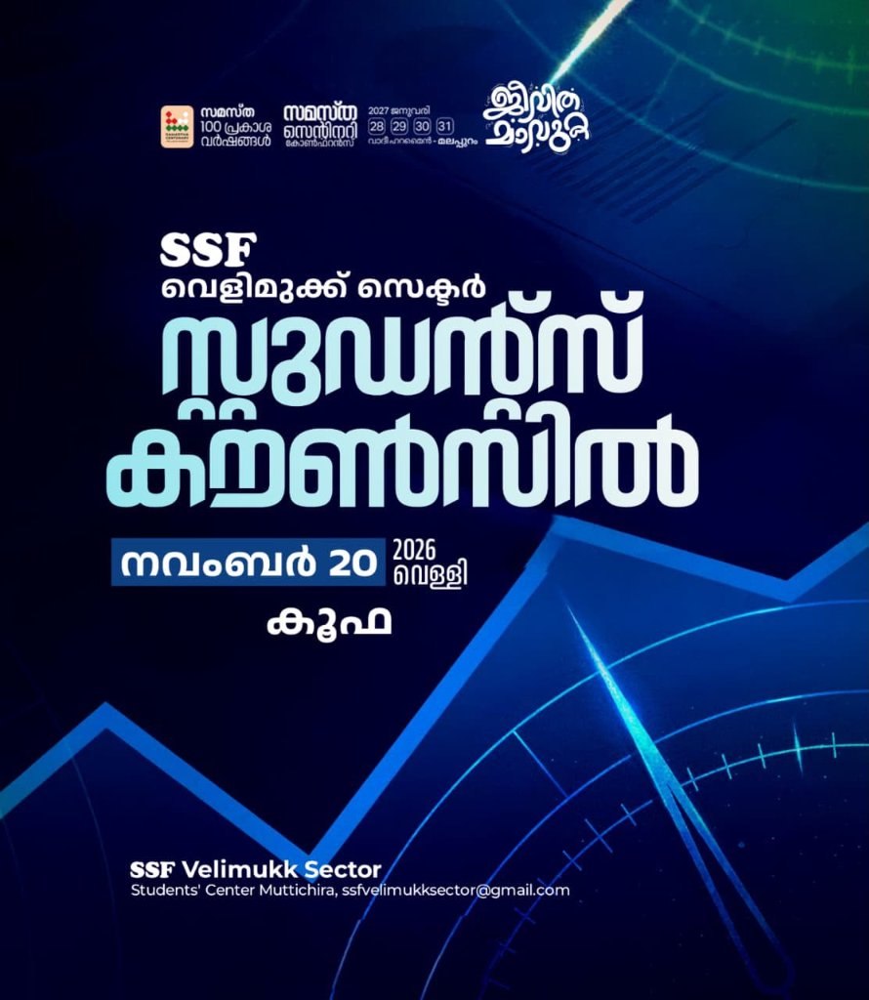

# SSF Velimukku Sector Students Council 2026 - Registration Portal

A modern, fast, mobile-first web portal built with **React**, **JavaScript**, and **Tailwind CSS** for the **SSF Velimukku Sector Students Council** held at **Koofa (കൂഫ)** on **Friday, November 20, 2026**.

Designed specifically for **seamless registration on smartphones**, instant digital badge generation, and easy access for delegates and organizers.



---

## 🌟 Key Features

### 1. 📝 Streamlined Delegate Registration (Mobile-First)
- **Only Essential Fields** (no blood group or unnecessary hurdles):
  - **Full Name** (പേര്)
  - **Mobile Number** (10-digit Indian phone number with live validation & duplicate check)
  - **Unit** (1-tap selection from the 10 official sector units via quick chips or dropdown)
  - **Designation** (Touch-friendly role selection from the 6 official designations)
- **Mobile Optimized**:
  - Full-screen friendly layout with large touch targets (48px+).
  - Proper numeric keyboard (`inputMode="tel"`) with +91 indicator.
  - 16px input font size to prevent iOS Safari auto-zooming.
- **Instant Duplicate Prevention**: Detects if a mobile number is already registered and immediately provides a 1-tap "View My Pass" button.
- **Celebratory Experience**: Confetti explosion on successful registration.

### 2. 🪪 Digital Delegate Pass / ID Badge
- **Personalized Council ID Badge** with delegate name, designation, unit, and ID (`SSF-VLM-2026-XXX`).
- **Personal Scannable QR Code** with official verification payload.
- **1-Tap High-Res PNG Download** rendered via HTML5 canvas (no server required).
- **Share to WhatsApp & Web Share API**: Direct one-click sharing of formatted pass details.
- **Print Pass**: Formatted for ID cards and lanyard printing.

### 3. 🔍 "Find My Pass" Easy Retrieval
- Allows delegates to look up and re-download their digital badge anytime by entering their mobile number or ID.
- Quick link right at the top of the registration page.

### 4. 📊 Council Desk / Admin Dashboard
- **Key Registration Insights**:
  - Total registered delegates across all units.
  - Active units count (out of 10).
  - Top participating unit & designation breakdown.
- **Mobile Card View & Desktop Table**:
  - On phones: Clean, stacked delegate cards with direct WhatsApp link, pass view, edit, and delete.
  - On desktop: Full tabular directory with instant search and unit/role filters.
- **Export to CSV / Excel** with 1 click.
- **On-spot Delegate Add & Quick Edit modals**.

### 5. 🌐 Clean English Interface
- 100% English interface with clear labels, intuitive icons, and clean typography.
- Visual theme tailored to the official event poster: deep midnight blue, glowing cyan accents, and modern glassmorphic styling.

---

## 🏛️ Official Sector Data Included

### 10 Units:
1. Velimukku Koofa
2. Mh Nagar
3. Velimukku Alungal
4. U H Nagar
5. Kaliyatta Mukku
6. Velimukku
7. Palakkal
8. Thalappara
9. Muttichira
10. Velimukk East

### 6 Designations:
1. President
2. General Secretary
3. Executive Secretary
4. Secretary
5. Secretariat Member
6. Sector Secretariat / Executive Member

---

## 🚀 How to Run Locally

```bash
# 1. Install dependencies
npm install

# 2. Run local development server
npm run dev

# 3. Build for production deployment
npm run build

# 4. Preview production build
npm run preview
```
